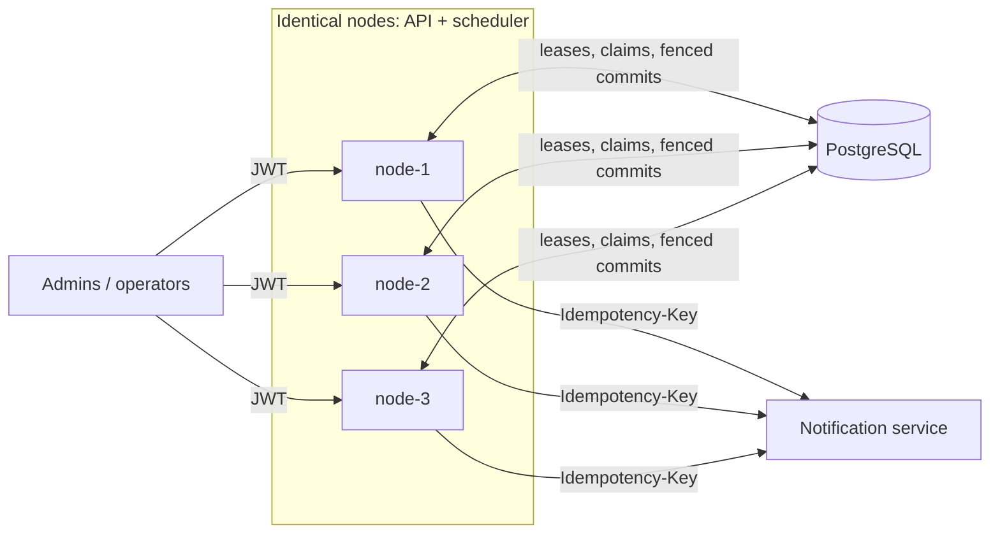
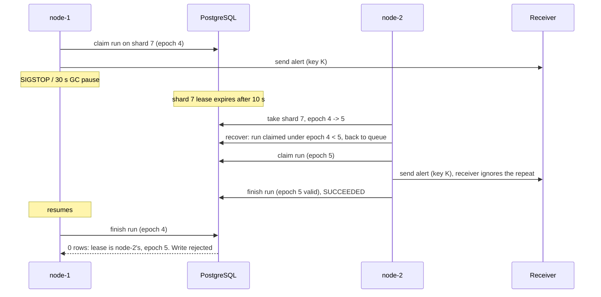

# Design note

## The short version

One PostgreSQL database, N identical Go nodes. Jobs are spread over 64 shards. Each shard has a lease row; its `epoch` goes up every time the shard changes hands and is the fencing token. A node only claims runs from shards it leases, and only commits a result if its lease (same epoch) is still valid. Every run carries an idempotency key, and the notification service ignores keys it has already seen.

## Exactly once: what is and isn't promised

Exactly-once *execution* is impossible. A node can send an alert and die before recording that it did. The next node cannot tell "sent but not recorded" from "never sent", so it must send again. What Tripora guarantees instead:

1. **At-least-once attempts.** A due run is retried until it succeeds or is dead-lettered. A dead or frozen node's runs are taken over.
2. **One key per occurrence.** The idempotency key is `sha256(job id, scheduled time)`. Every attempt of the same occurrence, on any node, sends the same key.
3. **The receiver deduplicates.** A repeated key is acknowledged but not delivered again. 1 + 2 + 3 means each employee gets exactly one alert.
4. **Fenced commits.** A node whose lease expired cannot write a result, even if it wakes up and tries.

## Architecture

**Tables** (`internal/store/schema.sql`):
- `jobs`: the definition.
- `runs`: one row per occurrence; a recurring job always has its next one stored.
- `shard_leases`: 64 rows of owner, epoch and expiry.
- `nodes`: heartbeats.
- `tenants`: pause flag and running cap.

**Node loop** (`internal/scheduler/node.go`):
- **Every 2 s:** heartbeat, renew leases, move toward an equal share `ceil(64 / live nodes)`, and recover runs from lost owners. A new node takes free shards, busy nodes release their surplus, and a dead node's leases expire so the survivors take them.
- **Every 100 ms:** claim due runs (one transaction), run each in a worker pool of 64 with `context.WithTimeout(max_runtime)`, then finish it with one fenced `UPDATE`.

**No single hot lock.** Each claim locks only the node's own lease rows (shared lock) and the runs it takes. Nodes never queue on a common row.

## Hardest flow: a node freezes mid-run

## Decisions

- **Which clock decides.** PostgreSQL's `clock_timestamp()`. It is used for every "is it due", "has the lease expired" and "retry at" check, so skewed node clocks cannot fire jobs early or steal leases. Nodes only use their own clock to pace polling and to time handler deadlines.
- **Daylight saving time.** Cron runs on the tenant's wall clock (IANA zone).
  - A wall time that does not exist (02:30 on the day clocks jump 02:00 to 03:00) is skipped that day.
  - A wall time that happens twice (01:30 on fall-back day) runs once, at the first 01:30.
  - Tested for New York, Berlin and Sydney.
- **Misfires.** A run is "missed" if it starts more than 60 s late (downtime, a long pause). Normal queueing never reaches that. Then:
  - `FIRE_NOW` runs every missed occurrence.
  - `COALESCE` (the default) runs once and continues from now.
  - `SKIP` records it as `SKIPPED` and continues from now.
- **Recurring jobs never get lost.** Claiming an occurrence inserts the next one in the same transaction.
- **Fairness.** A claim takes at most 20 runs per tenant and interleaves tenants: every tenant's first run comes before anyone's second. Per-tenant advisory locks make the running cap exact across nodes. In the tests, a tenant's 2,000 alerts do not delay another tenant's 20, which finish within the first 100 deliveries. In the 100k load test, the hot tenant (half of all jobs) had p99 fire lag 1.19 s and the other 49 tenants 0.35 s. The README also has a 50,000-alert burst run. Per-tenant locks are short, but in a burst every node takes the hot tenant's lock on each poll, so that one tenant is the point of contention, not the whole system.
- **Retries.** Exponential backoff with full jitter (1 s base, 5 min cap). After 5 attempts a run is dead-lettered. An operator can list dead letters and replay them, keeping the same key.
- **Restarts.** A node gets a fresh owner ID each time its process starts. A restarted node therefore cannot renew its dead predecessor's leases and slip past fencing.

## Failure modes

| Failure | What users see | Recovery |
|---|---|---|
| Node killed (kill -9) | Its in-flight alerts pause for up to one lease (10 s) | Lease expires; another node takes the shard (epoch+1), requeues the runs and re-sends with the same keys |
| Node frozen (SIGSTOP, GC pause) | Same as a kill | When it resumes, its writes fail the fencing check. Postgres also kills its idle transactions after 5 s, so it cannot hold locks |
| Notification service down | Alerts are late | Retries with backoff; dead letter after 5 attempts; operator replays |
| Handler hangs | That run times out | `max_runtime` cancels it; counted as an attempt |
| PostgreSQL down | Nothing runs; `/readyz` returns 503 | Work is durable in the database and resumes when it is back |
| One tenant floods the system | That tenant queues behind its cap | Other tenants keep their share of every claim |

## Trade-offs

- **Consistency over availability.** Every claim and commit goes through one PostgreSQL primary. If it is down, scheduling stops rather than risk duplicates. A managed primary with failover is the production answer.
- **Polling over push.** A 100 ms poll keeps fire lag low and the code simple. LISTEN/NOTIFY would cut idle queries but adds a second wake-up path.
- **Re-sends on failover and rebalance.** A taken-over run is sent again (deduplicated by the receiver) rather than tracked per recipient. This also happens when a node joins and another node hands over a shard with runs still in flight; nodes give away idle shards first to keep this rare. It is simpler, at the cost of some duplicate calls.

## Deliberately left out

Multi-region, job update and delete, per-tenant metrics labels, retention of old runs (a nightly `DELETE` of finished runs older than N days would do), and payload encryption at rest.

## Cost and limits

| Operation | Cost |
|---|---|
| Claim | One transaction per poll per node. Index range scan on `runs_due` for the node's shards, plus a window function over the due runs: O(due · log due) |
| Finish | One indexed `UPDATE` per run |
| Next fire time | O(1) cron evaluation; zones and cron strings are cached (bounded at 10,000 entries; they never go stale) |
| `/metrics` run counts | One database query per node per 5 s at most; the gauges are cached for 5 s, so they can be up to 5 s stale (bounded by the TTL) |
| Rebalance | Bounded by 64 lease rows; happens only when nodes join or leave |
| Node memory | O(workers) |

**Measured.**
- Claim path: about 1,110 runs/s per node (`BenchmarkClaim`).
- 100k spread over 10 minutes: p99 fire lag 0.57 s.
- 50k burst: drained at 480 runs/s under a per-tenant cap of 100, while the quiet tenant's p99 stayed at 0.086 s.

**Where it stops scaling.** Each run costs about two small transactions: a share of a batched claim, and a finish.
- **Database writes:** a single PostgreSQL primary handles a few thousand runs per second, so its write throughput is the limit.
- **Shard count:** with 64 shards, at most 64 nodes can usefully share the work.
- **Noisy tenant:** a single huge tenant is limited by its running cap.
- **Past the limit:** batch the finishes or partition the database by shard range.
